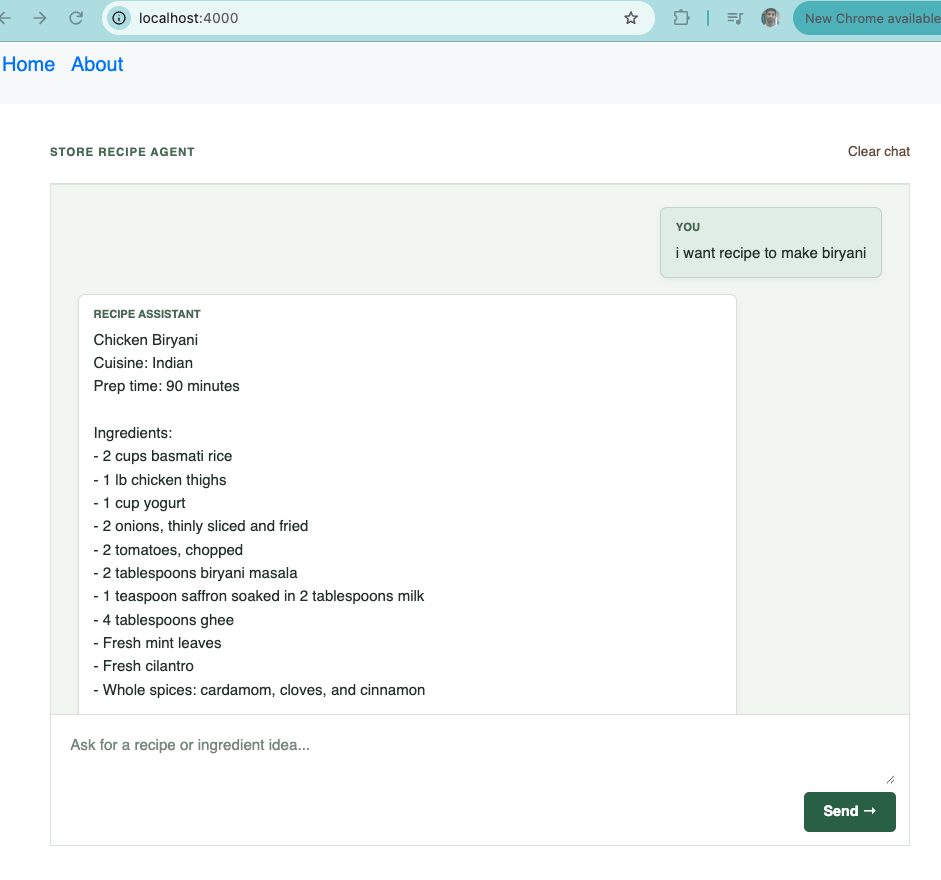

# AI Store Recipe Assistant

A Store recipe assistant prototype with a browser-based chat interface. It extracts recipe intent, looks up store products, and generates recipe suggestions using retrieval-augmented generation (RAG) over a local recipe dataset.

## Application flow

The Flask chat endpoint in `tdapp/pages.py` sends each user turn to the LangGraph workflow in `tdapp/core/workflow.py`:

1. `PromptHandler` identifies whether the request is recipe-related or asks for human-agent assistance, and extracts structured recipe intent using the `UserRecipeIntent` schema.
2. `RecipeHandler` requests store products through `store_products`. Product lookup uses MySQL filters for store and department; user-provided ingredients are prioritized and the combined list is capped at 10 items.
3. For recipe requests, the agent builds a recipe query from the extracted intent and available ingredients, then can retrieve relevant context from the FAISS index. The current RAG lookup returns one matching recipe document.
4. The workflow returns structured recipe data or a text response. The Flask endpoint formats that result for the chat transcript.

The chat page stores up to 50 displayed messages in browser `localStorage` and sends up to 20 prior turns with each request. Use **Clear chat** to remove the saved transcript. Human-agent requests currently resume with a placeholder message that a representative will follow up; no live human-agent service is connected.

`RAGHandler` uses OpenAI `text-embedding-3-small` embeddings over `tdapp/data/recipes_dataset.json`. If `faiss_index/index.faiss` is missing, the index is built from the recipe data and saved locally. This requires a working OpenAI API key.

## Requirements

- Python 3.13 or newer
- `uv`
- An OpenAI API key for intent decisions and embeddings
- An OpenRouter API key and base URL for chat-model requests
- A `DEPLOYMENT_NAME` accepted by the configured model providers
- MySQL and a database containing the `store_items` table for store-product lookups

## Setup

Install dependencies from the repository root:

```bash
uv sync
```

Create a `.env` file in the repository root. Keep credentials private and do not commit this file:

```dotenv
OPENAI_API_KEY=your-openai-api-key
OPENROUTER_API_KEY=your-openrouter-api-key
OPENROUTER_BASE_URL=https://openrouter.ai/api/v1
DEPLOYMENT_NAME=your-model-name

MYSQL_HOST=localhost
MYSQL_PORT=3306
MYSQL_USER=your-mysql-user
MYSQL_PASSWORD=your-mysql-password
MYSQL_DB=your-database-name

FLASK_APP=tdapp
FLASK_RUN_PORT=4000
```

The OpenAI key is used by the OpenAI client and embeddings; the OpenRouter values configure `ChatOpenAI`. The selected `DEPLOYMENT_NAME` must be available for the configured model calls.

Load the bundled product data into MySQL if the table has not already been populated. This command replaces the `store_items` table with data from the bundled product CSV:

```bash
uv run python -m tdapp.data.sql_loader
```

Only run the loader when you intend to create or replace that table.

## Run the Flask app

From the repository root:

```bash
uv run flask --app tdapp run --debug
```

Open <http://127.0.0.1:4000/> in a browser (or use the port configured by `FLASK_RUN_PORT`). Chat requests require access to the configured model providers and MySQL. If the FAISS index needs to be created, the first request also requires OpenAI embedding access.



## Run the standalone workflow

To run the interactive terminal version instead of the web chat:

```bash
uv run python -m tdapp.core.workflow
```

This uses a sample prompt and accepts subsequent prompts in the terminal. When an interrupt requests a human-agent response, the terminal flow prompts for one; the web flow currently uses the placeholder response described above.

## Main modules

- `tdapp/pages.py`: Flask routes, chat handling, interrupt resumption, and response formatting
- `tdapp/templates/pages/home.html`: browser chat UI and local transcript persistence
- `tdapp/core/prompt_handler.py`: intent detection, structured extraction, and chat responses
- `tdapp/core/workflow.py`: LangGraph orchestration and terminal chat loop
- `tdapp/core/recipe_handler.py`: store-product lookup and structured recipe generation
- `tdapp/core/rag_handler.py`: FAISS index loading and recipe-context retrieval
- `tdapp/core/state.py`: intent, recipe, and workflow data models
- `tdapp/functions/store_products.py`: combines store products with user ingredients
- `tdapp/core/utils.py`: MySQL product query
- `tdapp/data/recipes_dataset.json`: recipe corpus used by RAG
- `tdapp/data/document_loader.py`: converts recipe JSON entries into embedding documents
- `tdapp/data/sql_loader.py`: loads the bundled CSV data into MySQL
    